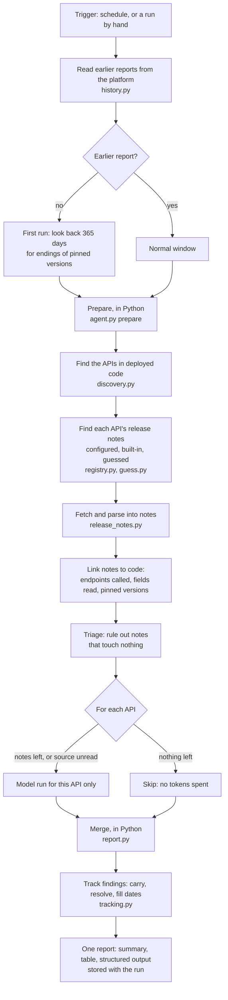
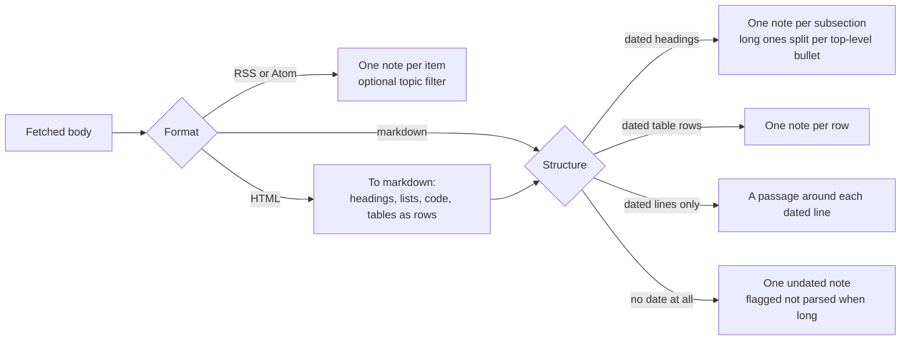
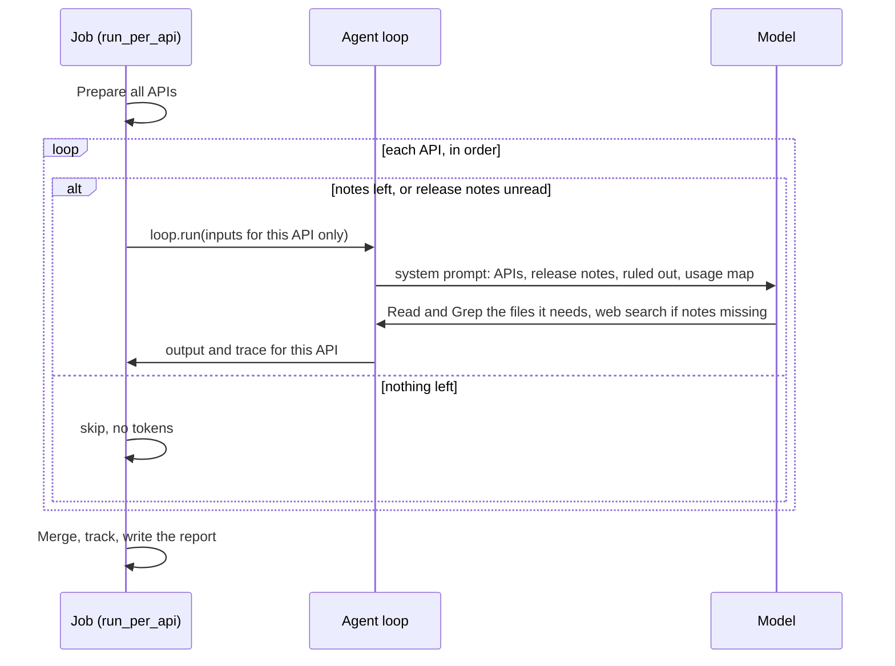
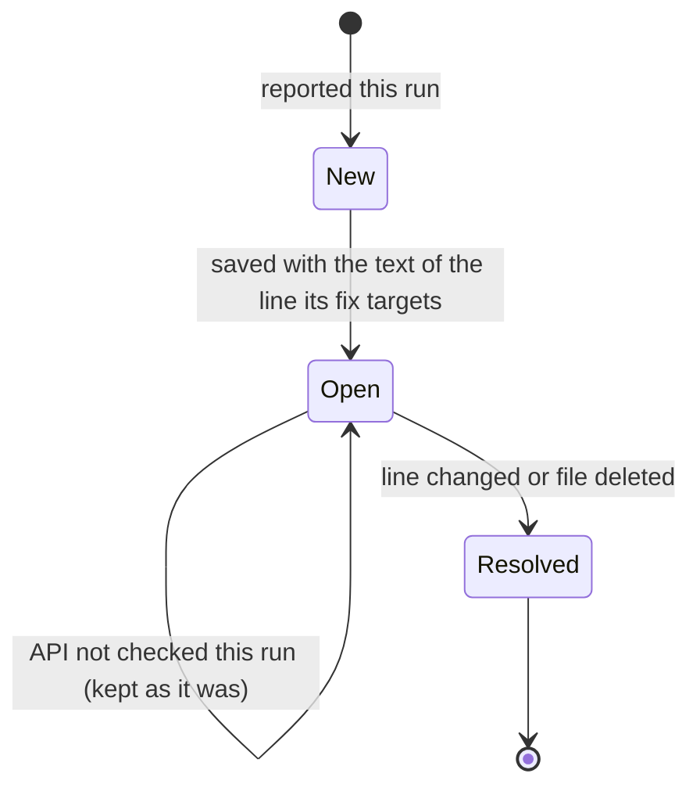

# api-change-monitor

A background agent that watches the release notes of the REST APIs a workspace's production
pipelines call. It finds breaking changes, deprecations, endpoint enhancements and new
endpoints, ties each one to the pipeline resources and downstream models it touches, and
recommends the edit to make. It runs unattended on a schedule and never edits code.

This file explains how the agent works. The contract lives in [AGENT.md](AGENT.md): its inputs,
its output schema, and the rules the model follows (what counts as success, the `Kind`,
`Impact`, `Dates` and `Versions` tables, the recommendation rules).

## At a glance

- **Deterministic first, model second.** Python finds the APIs, fetches and parses the release
  notes, matches them against the code and rules out what touches nothing. The model only
  reads what is left and writes the judgement: what lands when, and the edit to make.
- **One job, one model run per API.** The job splits the work by API, skips the model for an
  API with nothing left after triage, and merges the runs into one report in Python.
- **Memory between runs.** Open findings are carried from run to run until the code line they
  name changes, and a first run looks back for older endings of the version it pins.
- **Generic over APIs.** It works for any REST API it can see in deployed code. Known release
  note sources only make finding them faster; an unknown API is still watched by its host.

## How a job runs



The job is declared as one decorated function that calls `run_per_api` (the snippet is in the
`dlthub-platform` workflow). The same definition also works in the plain declared form,
`run.agent("dlthub-platform:api-change-monitor")`: then `agent.py`'s `validate_input` runs the
same preparation and hands every API to a single model run, without memory between runs.

## Step by step

### 1. Earlier reports (`history.py`)

The job reads the results of up to 5 earlier completed runs of the same job from the platform
(`dlthub_sdk`: current run → its job → the job's runs → each run's stored result). Their saved
findings are combined: the newest report decides which findings are open, and an older report
fills a date the newer ones left empty. A local run, or a platform lookup that fails, starts
with no history and says so in the report; every finding then counts as new, none is lost.

Whether any earlier report exists decides whether this is a **first run**.

### 2. Which APIs (`discovery.py`)

**Production code** is what `__deployment__.py` imports, followed through the workspace's own
modules (absolute and relative imports). A workspace without a deployment module is scanned
whole.

An API is found by:

| signal | where | how |
|---|---|---|
| a URL in code | every string literal and f-string in production code | read from Python's syntax tree, so `requests.get(...)`, `RESTClient(base_url=...)` and session calls all count; docstrings and comments do not |
| a URL in config | `.dlt/*.toml`, never `*secrets.toml` | lines naming a url, endpoint or client |
| an imported module | production code | only for names the built-in source list knows |

A templated host label becomes `*`: `https://{subdomain}.acme.com` is `*.acme.com`. Hosts that
are no data API (docs sites, package indexes, dltHub itself) are ignored. A known host gets the
known name; any other API is named by its host.

The `apis` input replaces discovery with an explicit list, each entry a name or
`name=<release notes url>`.

For every API discovery also records:

- **the files that call it**, so its notes are matched against its own code only;
- **pinned versions**: a name holding `version` set to a date or dotted number, or a version
  segment in a URL (`/v1/`, `/api/2025-01/`), with credentials masked;
- **the downstream model files**: SQL files and Python files under a models or transformations
  folder.

### 3. Where the release notes are (`registry.py`, `guess.py`)

Sources are tried in this order:

1. **configured**: a URL given in the `apis` input, or a workspace entry in
   `.dlt/config.toml` (below);
2. **built-in**: a known API's sources in `registry.py`, with optional feed topics and a
   version pattern for pages without dates;
3. **guessed**: for any other API, the common changelog places on the provider's own domain,
   fetched in parallel with a short timeout: `/changelog`, `/changelog.rss`, `/release-notes`,
   `/docs/changelog`, `/api/changelog` on the domain and its `developer.`, `developers.` and
   `docs.` subdomains. The first page that parses into dated notes wins. `api.acme.io` gives
   the provider domain `acme.io`;
4. **searched**: an API still without readable notes goes to the model, which finds its
   changelog with `WebSearch` and `WebFetch` on the provider's domain.

#### Workspace entries

`registry.load` lays the workspace's own entries over the built-in list by name, so a workspace
adds APIs and replaces built-in sources without touching the toolkit:

```toml
[api_change_monitor.sources.acme]
hosts = ["api.acme.io"]
urls = ["https://developers.acme.io/page/changelog"]
topics = []
version = ""
modules = []
```

The `add-api-change-source` skill writes these entries after proving, with this agent's own
reader, that the source can be dated. An entry without a URL is skipped. Workspace entries are
matched before built-in ones.

### 4. Reading the notes (`release_notes.py`)

One reader for every format:



Dates are read as `2026-09-30`, `September 30, 2026`, `Sep 30 2026`, `Aug 1st, 2026` and
`30 September 2026`. A page that names no charset is read as UTF-8.

The whole history of each source is parsed. A note then enters the run when:

- it was published on or after the window start (`since`, else the schedule's interval, else
  7 days back); or
- it is undated (the page describes the current release as a whole); or
- it names a date in the next **60 days** (label `deadline <date>`), so an old announcement
  comes back before its deadline; or
- on a **first run**, it was published in the last **365 days**, names a version the workspace
  pins and announces an ending (deprecated, sunset, retired, removed, out of support,
  breaking); label `earlier note on pinned <version>`.

The newest dated entry per API is recorded for the coverage line of the report.

### 5. Linking notes to the code (`agent.py`)

Each note is checked against the code that calls its API:

| fact | how | shown to the model as |
|---|---|---|
| endpoints called | endpoint templates the note names (`GET /repos/{owner}/{repo}`, backticked paths) matched against resource paths in code; trailing parameters optional, a base-path prefix may be skipped, a code placeholder matches only a template parameter | `called by this workspace` |
| fields read by models | identifier-shaped names in the note (with `_`, `.`, a digit or camelCase), also as their dlt column (`customer.email` → `customer__email`), matched in model files, whole or as one segment of a column path | `read by downstream models` |
| fields named in pipeline code | the same names in the API's own pipeline code, such as a query selecting them | `named in pipeline code` |
| pinned version named | a version the workspace pins, written outside an endpoint path | `names the pinned version` |
| version of the change | `version X` in the title, or a version-shaped label | `api version` |

### 6. Triage

A note is **ruled out** only when the script checked its names and none matched: it names an
endpoint, or at least 3 field names, and none is called, read or named, it names no pinned
version, and it is neither imminent nor unparsed. Everything else goes to the model. A note
that names nothing checkable always goes to the model, so the triage fails open.

Ruled-out notes are listed by title only, so the model can overrule one.

### 7. One model run per API



The prompt for one API holds that API's line, its notes (bounded to 60,000 characters, each
note to 1,800–6,000 depending on room), its ruled-out titles and its usage map. Runs are
sequential, since the loop is not shared safely. A run that hits a turn or token limit marks
its API "not checked" and the others go on. The job stops starting runs past 3,000,000 tokens
in total.

### 8. Merging and tracking (`report.py`, `tracking.py`)

The report is written in Python from the structured results, so its shape never depends on
the model:

- rows take their API from the run they came from;
- free text the model wrote is passed through credential masking;
- a run that says `failed` only because a note left a question open (an `unknown` finding) is
  counted as `succeeded`; only unreadable release notes, an abort or an unfinished run fail
  the job.



`action_required`, `unknown` and `on_upgrade` findings are tracked. Each keeps the text of the
line its recommendation targets (or of its affected lines), masked. A finding repeated with a
new title is recognised by the same line, or by the same kind, effective date and file. A
repeated finding keeps its first-reported date and any date an earlier report found.

## The report

The `summary` shown on the run page:

| section | content |
|---|---|
| `Action required` | one bullet per API: how many changes, the earliest date (marked passed), the models they break |
| `On upgrade` | per API: changes waiting on a version upgrade, and when the pinned version ends |
| `Opportunities` | enhancements and new endpoints worth adopting |
| `Open questions` | what a person has to check, one line each, under its API |
| `Scope` | the window, notes read, notes per API, APIs without changes, newest note per API and coverage gaps, cost, earlier findings still open and resolved |
| `Changes` | the table: api, lands, impact, change, where, change to make, reported |

The structured output adds `changes`, `sources`, `open_points`, `requires_human`, `runs` (one
entry per API with status, turns and tokens) and `tracked` (the findings the next run reads).

## Safety

- **Access**: `local: read` for the workspace files and `local: network` for the web search
  fallback. No `execute`, no `data`, no MCP server: fetched text can only steer the output.
- **Profile**: deploy with `require={"profile": "access"}`, never `prod`.
- **Credentials**: secret files are never read. Credential-shaped literals in code (values of
  key, token, secret and password names; Bearer and Basic headers; known token prefixes; long
  mixed keys) are masked as `***` in the prompt, the report and the fingerprints stored on the
  platform.
- **Third-party text**: release notes are data; the prompt tells the model instructions inside
  them are not addressed to it.

## Configuration

| setting | where | effect |
|---|---|---|
| `apis` | job input | watch these APIs instead of the discovered ones; `name` or `name=<url>` |
| `since` | job input | first day of the window; else the schedule's interval, else 7 days |
| `reviewed_versions` | job input | `name=version` of undated release notes already reviewed, skipped until a new version |
| `AGENT__MODEL`, `AGENT__API_KEY` | workspace variables | the model; at least as capable as Claude Sonnet 5, with web tools for the search fallback |

Limits per model run come from `AGENT.md` (`max_turns: 24`, `max_tokens: 1000000`).

## Files

| file | role |
|---|---|
| `AGENT.md` | the definition: access, inputs, output schema, system prompt |
| `agent.py` | `prepare`, `validate_input` (declared form), `run_per_api` (one job) |
| `discovery.py` | production code, APIs, pinned versions, resource paths, usage map, model files |
| `registry.py` | built-in release note sources, workspace entries from `.dlt/config.toml`, the hosts to ignore |
| `guess.py` | common changelog places for an unknown API |
| `release_notes.py` | fetching, parsing every format, dates, endpoints and fields in notes, the window |
| `report.py` | merging per-API runs, the summary and the table |
| `tracking.py` | carrying findings across runs, fingerprints, combining earlier reports |
| `history.py` | reading earlier reports from the platform |
| `redact.py` | masking credentials |

Tests: `tests/api_change_monitor/` for every module, and `tests/agents/test_agents_run.py` for
whole offline runs of both the declared form and the single job.

## Known limits

- **Sources the generic path cannot find.** Changelogs at provider-specific paths (for example
  under `/page/changelog`) are found by the model's search in the run; the
  `add-api-change-source` skill saves them as workspace entries so later runs read them
  directly.
- **SDK-only pipelines.** A pipeline that calls an API through an SDK, with no URL in the code,
  is found only for module names a built-in or workspace entry lists.
- **First-run lookback is per job.** An API added to a workspace whose job already has a report
  does not get the lookback on its first check.
- **Model consistency.** Smaller models apply the rules unevenly between runs: a replacement
  field's type, which date of a phased change counts, whether an authentication change breaks a
  model. Pin a model at least as capable as Claude Sonnet 5.
